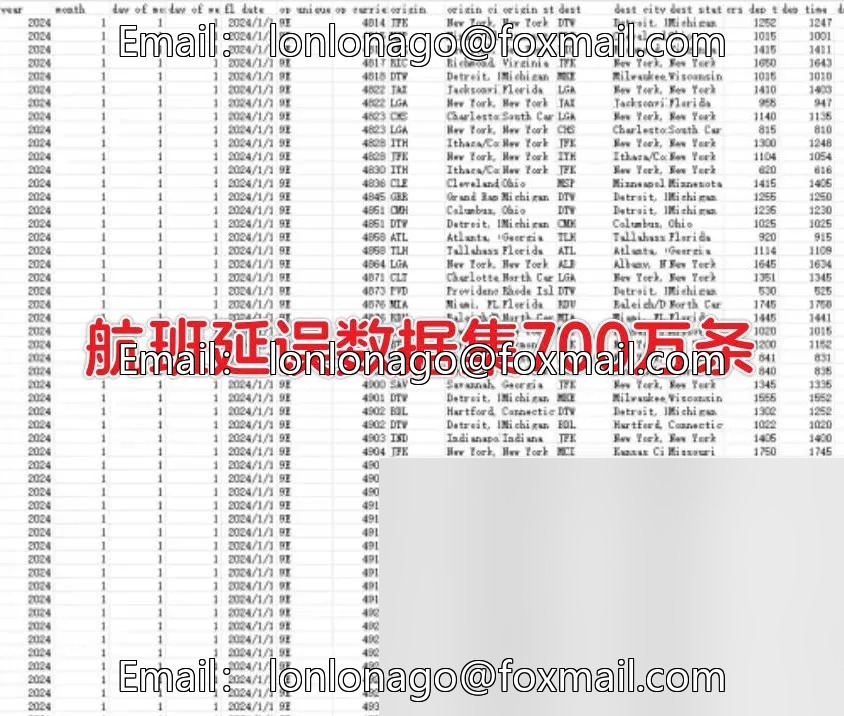
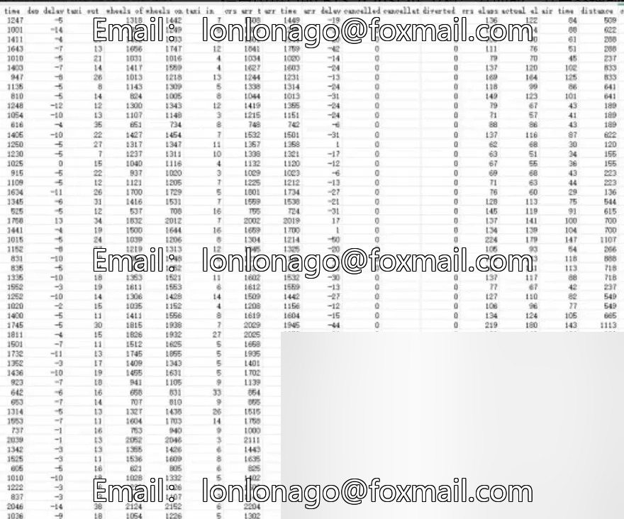
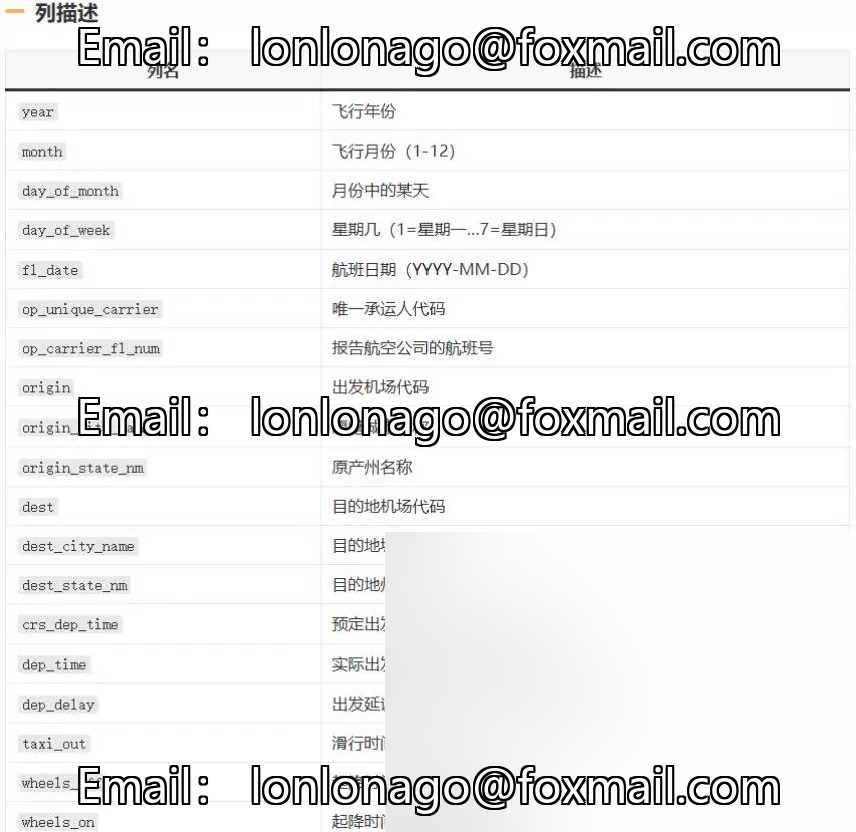
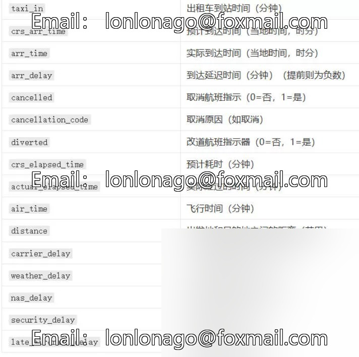

# Flight delay dataset of 7 million entries

## Body

Flight delay dataset of 7 million entries

The dataset includes detailed flight performance and delay information for US 2024 flights, which are merged into the BTS TranStats files monthly and organized into a dataset. It contains more than 7 million rows and 35 columns of data, providing comprehensive information on scheduled and actual flight times, delays, cancellations, rerouting, and inter-airport distances. The dataset is suitable for exploratory data analysis (EDA), delay prediction, machine learning tasks, time series analysis, and airline/airport performance research.

Time: January 2024 to December 2024

Downloaded monthly CSV files from the BTS TranStats on-time rate database, and selected 35 related columns.

Using Pandas to merge monthly files into a single dataset, cleaning steps include standardizing column names to snake_case (e.g., flight_date, dep_delay), converting flight_date to ISO format (YYYY-MM-DD), converting cancelled and converted diverted to binary indicators (0/1), and filling missing values for delay-related columns (carrier_delay, weather_delay, nas_delay, security_delay, late_aircraft_delay) with 0, while preserving all other values in the original data.

File description
flight_data_2024.csv Complete cleaned dataset (approx. 7 million rows, 35 columns)
flight_data_2024_sample.csv Sample dataset (10,000 rows)
flight_data_2024_data_dictionary.csv Column names, data types, null percentage and example values

web-based shipment, can be directly photographed and shipped.

The dataset contains 7 million flight delay records from U.S. 2024 flights, merged from BTS TranStats monthly files; it includes 35 columns covering reservations, delays, cancellations, reroutes and airport distances, suitable for EDA, delay prediction and time series analysis.

<!-- AI_ENRICHED -->

## Images

## Payment

Here is a pay link on Stripe ( https://buy.stripe.com/3cs8yP7sY87d0vu9AB ). Please contact me lonlonago@foxmail.com after funding $89, and I will send you a complete data files , thank you!

